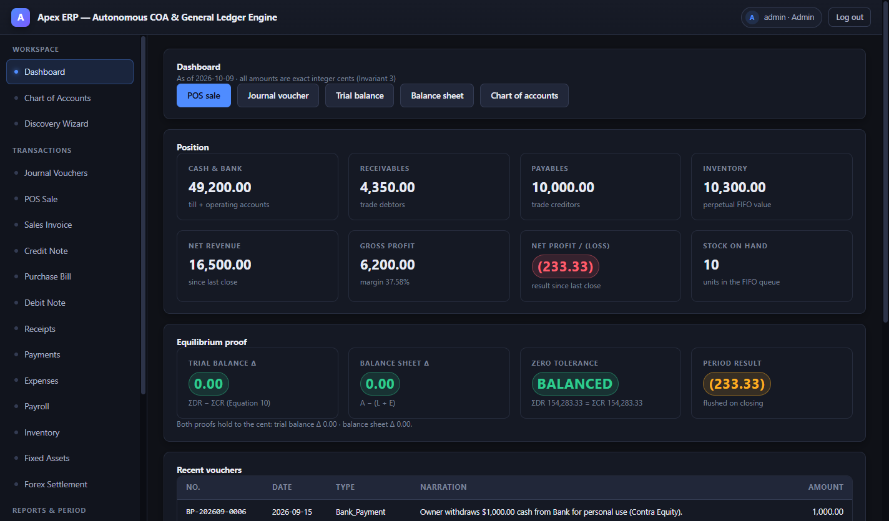
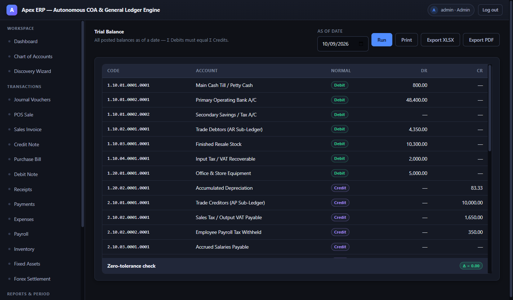
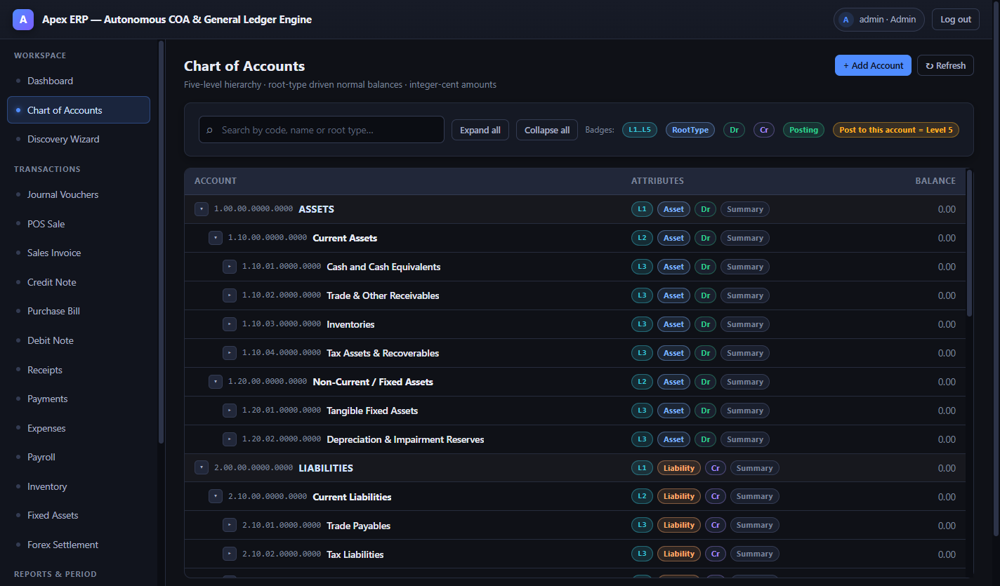
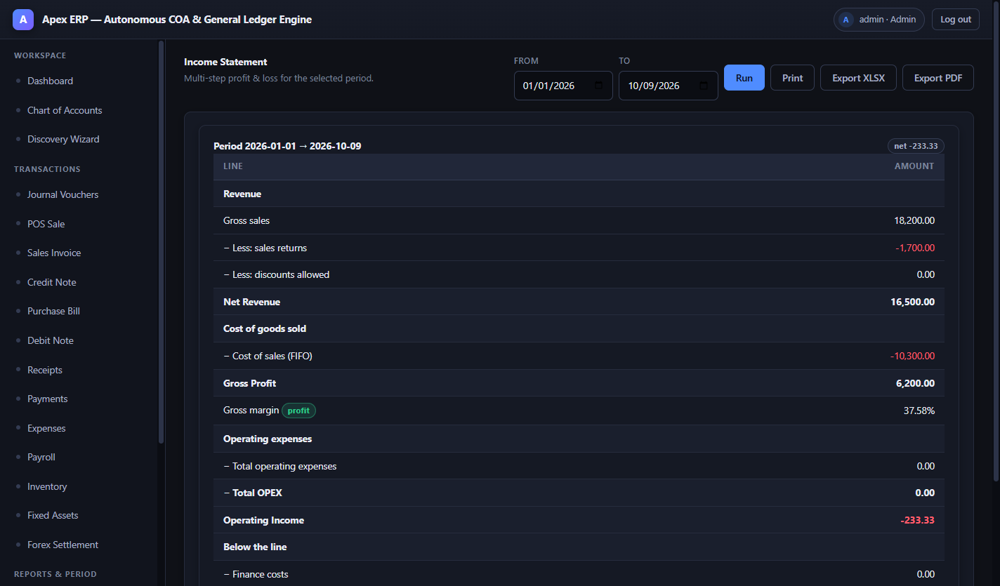
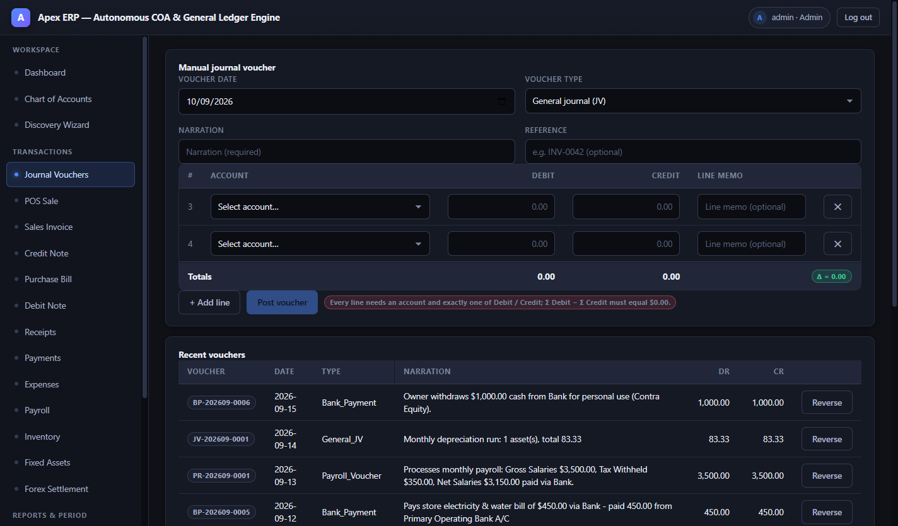
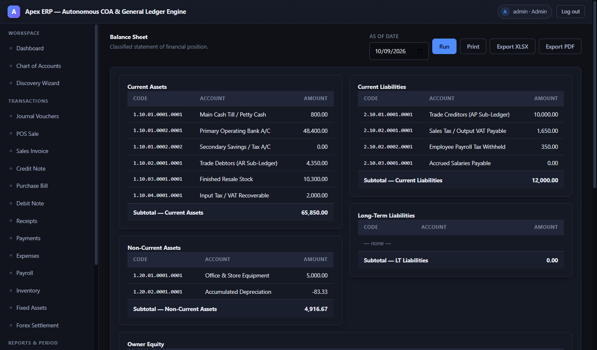

<div align="center">


# Apex ERP

**Autonomous Chart of Accounts & General Ledger Engine**

An offline, single-user desktop ERP that owns the whole accounting core:
a five-level chart of accounts, an append-only double-entry ledger in exact
integer cents, inventory FIFO, tax, payroll, fixed assets, multi-currency
settlement, period closing and the financial statements — all without a
server, a network connection or a single floating-point number.

[](package.json)
[](#install-on-another-machine)
[](https://www.electronjs.org/)
[-0f1117)](#architecture)
[](#verification)
[-c0392b)](#license)

**86 unit tests · 87 acceptance assertions · 21-screen shell smoke · zero
tolerance on `ΣDR − ΣCR`**

</div>

---

## Screenshots

Regenerate any time with [`npm run shots`](#verification) — the tour boots the
real shell, signs in through the login form and captures every flagship screen.

| Dashboard | Trial balance |
|---|---|
|  |  |

| Chart of Accounts | Income statement |
|---|---|
|  |  |

| Journal voucher (live Δ preview) | Balance sheet |
|---|---|
|  |  |

More in [`docs/screenshots/`](docs/screenshots): login, COA discovery wizard,
inventory FIFO, payroll, period closing & backup.

---

## Why it exists

`MASTER_ERP_SPECIFICATION_FULL.docx` (SRS v3.0.0) defines six phases of an
accounting engine and a published 15-transaction case study with figures that
must match **to the cent**. This repository implements all six phases and the
Electron UI, and then proves the numbers three independent ways:

| Section 6 check | Result |
|---|---|
| Trial balance columns | **90,283.33 = 90,283.33**, Δ 0.00 |
| Gross ledger Δ (Invariant 1) | 0.00 |
| Gross profit | 6,200.00 (37.58%) |
| Net profit / (loss) | (233.33) |
| Assets | 70,766.67 = L 12,000.00 + E 58,766.67, Δ 0.00 |
| Bank / till / AR / stock | 48,400.00 / 800.00 / 4,350.00 / 10,300.00 (10 × 1,030.00 FIFO) |
| Vouchers | 15, real numbers (BR/BP/PI/CR/SI/CN/PR/JV-202609-####) |

The SRS tables carry one `$1,000.00` arithmetic typo (bank `49,400 → 48,400`);
[`docs/DEVIATIONS.md`](docs/DEVIATIONS.md) §1 shows why the engine's figure is
the self-consistent one — every other published figure matches to the cent.

---

## Features

- **Exact integer cents** — money never becomes a float anywhere in the engine;
  only the renderer formats it. There is no rounding drift to hide.
- **Zero-tolerance double entry** — `|ΣDR − ΣCR| = 0.00` is enforced *before*
  the transaction commits; a balanced voucher is a precondition, not a report.
- **Five-level chart of accounts** — root-type driven normal balances, summary
  heads that reject journal lines (kernel + SQL trigger), contra accounts, and
  a 7-step discovery wizard that extends the COA deterministically.
- **Append-only ledger** — corrections happen by reversal, never by edit; every
  voucher carries an audit trail (who, when, source module).
- **Inventory** — perpetual FIFO lots, COGS on every sale, stock-out guards,
  physical-count shrinkage with a FIFO write-off preview.
- **Tax** — inclusive/exclusive 10% split, input/output VAT accounts, tax from
  trade discounts *before* tax, receivable/payable reconciliation.
- **Payroll** — gross → tax slab → pension → net, with the kernel cross-checking
  the on-screen calculation (`Kernel ✓`) before the voucher is allowed to post.
- **Fixed assets & FX** — registration, depreciation runs, book value; foreign
  invoice settlement with `V_orig / V_settle / Δ` gain-or-loss preview.
- **Period control** — close (flush P&L into Retained Earnings), reopen, and a
  `CLOSED_PERIOD` rejection for anything that tries to post into a locked month.
- **Reports & export** — trial balance, multi-step income statement, classified
  balance sheet, ledger card, dashboard proofs — each exportable to **XLSX** and
  **PDF**, plus verified `.db` backup snapshots with a restore catalogue.
- **RBAC** — Admin / Accountant / Cashier enforced at the single IPC entry
  point, never in the UI.

---

## Quick start (development)

```powershell
npm install
npm test              # 86 unit tests
npm run verify        # 87 Section-6 acceptance assertions
npm run seed -- --fresh   # post the 15-transaction case study
npm start             # Electron shell  (admin / admin123)
npm run smoke         # headless shell: login + 21 routes + reports + RBAC
```

> **Windows PowerShell:** use `npm.cmd` — the `npm.ps1` shim is blocked by the
> default execution policy.

Requires Node ≥ 20. The ledger lives in `data/apex_erp.db` and is created from
the seeder on first run; delete it (or re-run `npm run seed -- --fresh`) to
reset the demo data.

---

## Install on another machine

```powershell
npm.cmd run dist          # icon + verified seeded ledger + NSIS installer
# -> release\ApexERP-Setup-3.0.0.exe   (~83 MB)

npm.cmd run dist:dir      # unpacked folder only, for a quick look
npm.cmd run check:install # audit an installed copy (11 assertions)
```

The target machine needs **no Node, no npm and no repository**:

- `scripts/buildAppDb.js` posts *and verifies* the case study into
  `build/apex_erp.db` at build time — **the build fails** if the trial balance
  is not `90,283.33 = 90,283.33`.
- The installer is **per-user** (no admin prompt), drops `Apex ERP.exe` in
  `%LOCALAPPDATA%\Programs\Apex ERP` with Start Menu and Desktop shortcuts, and
  `Uninstall Apex ERP.exe` removes the app while deliberately keeping your
  ledger in `%APPDATA%\Apex ERP`.
- On first run the verified ledger is copied into `%APPDATA%\Apex ERP`
  (temp-file + rename, only if absent), so every installation opens with the
  same numbers. Delete that folder to get the demo data back.
- The binary is **not code-signed**, so SmartScreen shows *"Windows protected
  your PC"* → **More info → Run anyway**. Signing and auto-update are
  deliberately out of scope (see [DEVIATIONS §19](docs/DEVIATIONS.md)).
- A second launch focuses the first window instead of putting two writers on
  the same ledger.

---

## Sign in

| user | password | role | can |
|---|---|---|---|
| `admin` | `admin123` | Admin | everything — users, settings, close/reopen, backup, export |
| `accountant` | `account123` | Accountant | post, reverse, manage COA, report, close, backup, export |
| `cashier` | `cash123` | Cashier | post and run reports — **only** |

RBAC lives in `kernel.invoke()`, the only entry point the renderer has. The
session role is owned by the kernel (`auth.login` / `auth.logout`) and is never
taken from the payload, so it cannot be forged. Restricted nav entries are
hidden, restricted routes bounce to the dashboard, and the kernel re-checks
every call regardless of what the UI allows:

```
Not authorised: role "Cashier" cannot "close_period" (closing.closePeriod).
```

---

## Verification

| command | what it proves |
|---|---|
| `npm test` | 86 unit tests — money, tax, payroll, ledger, inventory, closing, RBAC, preview parity, case study |
| `npm run verify` | 87 Section-6 acceptance assertions, re-seeded into a clean database and re-derived independently |
| `npm run smoke` | the **real** shell: form login, 21 routes, live reports, RBAC gate, dashboard proofs, Phase-6 close/reopen/backup in an isolated database |
| `npm run shots` | screenshot tour → `docs/screenshots/*.png` |
| `npm run check:install` | re-derives the case study from an *installed* database (11 assertions) and exits non-zero on any mismatch |

```
npm test       -> 86/86 pass, 0 fail
npm run verify -> 87/87 assertions, exit 0
npm run smoke  -> SMOKE_SHELL PASS bad=0 exit=0
```

---

## Architecture

```
┌──────────────────────────────────────────────────────────────────┐
│ index.html · preload.js · main.js   Electron shell                │
│   contextIsolation: true · exactly ONE IPC channel: erp:invoke   │
└──────────────────────────────┬───────────────────────────────────┘
                               │  (method, args)  — integer cents only
┌──────────────────────────────▼───────────────────────────────────┐
│ src/main/kernel.js       method table · RBAC gate · service wiring│
├──────────────────────────────────────────────────────────────────┤
│ 16 services: ledger · transaction · inventory · tax · payroll ·   │
│ asset · forex · account/COA · report · closing · auth · backup ·  │
│ export · validation · coaGenerator · settings                     │
├──────────────────────────────────────────────────────────────────┤
│ src/database/           schema.sql · migrations · dual driver     │
│                          (better-sqlite3 → node:sqlite fallback)  │
└──────────────────────────────────────────────────────────────────┘
```

```
main.js  preload.js  index.html    Electron shell (one IPC channel: erp:invoke)
src/main/kernel.js                 IPC façade / method table / service wiring
src/database/                      schema.sql, migrations.js, dual-driver db.js
src/services/                      16 services
src/ui/                            22 screens + shell (vanilla ES6, no framework)
scripts/                           seedDemoData, verifyCaseStudy, smokeShell,
                                   buildAppDb, shootScreens, makeIcon
tests/                             node --test suites
docs/                              API_CONTRACT.md, DEVIATIONS.md, screenshots/
```

- **Transport:** `window.erp.invoke(method, args)` → `ipcMain.handle` →
  `kernel.invoke(method, args)`. Errors cross the contextBridge as
  `"CODE :: message"` and are revived with `.code` intact
  ([`docs/API_CONTRACT.md`](docs/API_CONTRACT.md)).
- **Storage:** SQLite in WAL mode. `better-sqlite3` under Node, Electron's
  built-in `node:sqlite` in a packaged build — probed with a real statement,
  chosen at runtime, invisible to the services.

---

## Invariants (SRS Section 2)

1. **Exact integer cents** — money never becomes a float; only the renderer formats.
2. **Zero-tolerance balance** — `|ΣDR − ΣCR| = 0.00` enforced before commit.
3. **Level-5 leaf postings** — summary heads reject journal lines (kernel + trigger).
4. **Append-only vouchers** — corrections happen by reversal, never by edit.

---

## Deviations

Every intentional difference from the SRS is written down in
**[`docs/DEVIATIONS.md`](docs/DEVIATIONS.md)** — the SQLite driver fallback, the
$1,000 case-study typo, payroll tax-slab conflict, added COA nodes, extra
inventory movements, RBAC enforcement, the error-code envelope, the Promise
confirm dialog, the Windows installer (§19) and the dashboard equity-window /
`classList` fixes (§20). Nothing is changed silently.

---

## License

UNLICENSED — all rights reserved. See [`package.json`](package.json).
